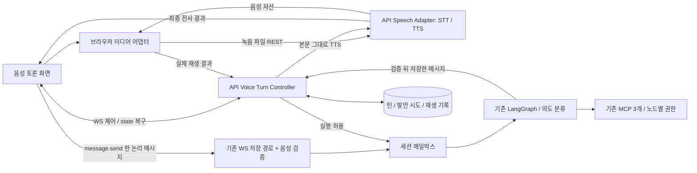
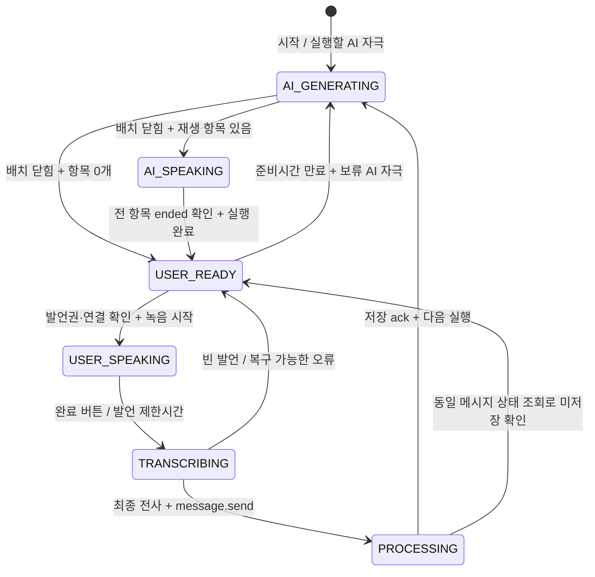

# 턴 기반 음성 그룹 토론 전환 설계

현재 동작·설계 대비 구현 범위는 [음성 구현](voice.md)과 [계약](../contracts/voice.md)이 기준이다. 본문의 제안·비교는 선정 근거이며 미구현 제안을 현재 기능으로 해석하지 않는다.

작성일: 2026-10-22 · 상태: **설계안 / 미구현** · 결정 기록: [V1~V5](../decisions.md#2026-10-22-턴-기반-음성-토론-전환-설계)

음성 후보·가격·무료 전용 운영·독립 서비스 인터페이스와 비용 원장은 [음성 서비스·비용 설계](voice-services.md)(V6·V7)를 함께 읽는다. 해당 문서는 공급자별 timeout·한도에 대한 이 문서의 일반 기본안을 구체화한다.

이 문서는 요청된 목표 구조와 구현 전 검토할 정책을 기술한다. 현재 동작의 정본인 [PRD](../../PRD.md), [하네스](harness.md), [세션 생명주기](session-lifecycle.md), [계약](../contracts/README.md)을 대체하지 않는다. 본문의 새 경로·필드·수치·파일명은 모두 **제안**이다. 기능 구현, 스키마·프롬프트·실제 계약 변경은 이번 산출물에 포함하지 않는다.

## 1. 목표와 분석 근거

지원자 1명과 AI 동료 3명이 발언권을 번갈아 갖는다. AI는 검증된 텍스트를 만든 뒤 TTS로 순차 재생하고, 지원자는 마이크로 발언한 뒤 최종 STT 텍스트 한 건을 기존 `message.send`로 제출한다. 입력창·말풍선·입력 중 표시는 토론 화면에서 제거한다. 동시 발언, AI 발언 중 지원자 끼어들기, 실시간 양방향 오디오, 부분 STT 전송은 범위 밖이다.

유지하는 제품 원칙은 동등한 참여자 4명, 시나리오 고정, 결정적 합의·시간 초과, 토론 태도만 보는 평가, 지원자 행동 근거 보존과 담당자의 최종 평가다. 음색·억양·발음·유창성·말의 속도를 새 평가 요소로 추가하지 않는다.

### 1.1 확인한 기존 경계

| 근거 | 현재 구조 | 음성 전환에 필요한 차이 |
|---|---|---|
| [AGENTS.md](../../AGENTS.md), [overview.md](overview.md) | API 단일 프로세스, DB 쓰기 API 소유, MCP 3개와 워커 분리 | Voice Turn Controller는 API의 별도 모듈. 음성 전용 서비스·MCP·LLM 에이전트를 추가하지 않음 |
| [agents.md](agents.md), `services/api/app/agent/debate/graph.py` | `load → cards → turn → respond → guard → stance_check → wait_typing → apply → fill`; 실행당 화자 0~2명 | 화자 수·순서는 그래프가 계속 결정. Controller는 그래프 결과의 전달 순서와 발언권만 관리 |
| [harness.md](harness.md) | 역할별 LLM 5개, 토론 그래프는 체크포인터 없이 DB 재로딩, 워커만 PostgresSaver | 역할 모델·프롬프트·LLM 복구 그대로. 음성 상태는 별도 DB 기록으로 복구 |
| [session-lifecycle.md](session-lifecycle.md), `app/mailbox.py` | 자극 4종 직렬 실행, `agent_runs` 영속 기록, 게시 직전 generation 검사 | 사용자 턴 예약 중에는 새 AI 실행을 보류. 실행 완료와 재생 완료를 별도 기록 |
| [ws.md](../contracts/ws.md), `app/routers/ws.py` | `message.ack`는 저장 확인, `message.new`는 게시. `typing.stop`은 완료 신호가 아님 | 음성 배치의 닫힘과 항목별 재생 확인을 추가. 기존 이벤트만으로 완료 추정 금지 |
| `app/services/debate.py`의 `save_candidate_message` | `client_msg_id` 멱등 확인 → 현재 `session.phase`로 저장 → generation 증가·run 예약 | 음성 턴·시도·원래 phase를 검증하는 진입 어댑터 필요. 늦은 STT를 현재 단계로 저장하면 안 됨 |
| [scenario.md](../product/scenario.md), [rubric.md](../product/rubric.md) | 카드 전달은 메시지 게시 기준, 메시지 수·응답 간격은 텍스트 기준 | 게시와 재생 확인 분리. 음성 장애·처리 지연이 지원자 행동으로 해석되지 않도록 입력 보완 |
| [web 설계](../services/web.md), `components/debate/use-session.ts` | `/state` + WS 증분, seq 공백·재연결 시 재조회 | 같은 복구 경로에 음성 스냅샷 추가. 메시지는 내부 데이터로 유지하고 음성 화면만 새로 구성 |

### 1.2 이번 산출물 계약

| 산출물 | 작성 책임 | 다음 단계에서 읽는 방법 |
|---|---|---|
| 이 문서 | 설계 작성자 | 구현자는 상태·불변식·계약 제안과 테스트 ID를 함께 읽고 구현 PR의 범위를 정함 |
| `docs/decisions.md`의 V1~V5 | 설계 작성자, 정책 확정은 제품 담당자 | 요청 확정 사항과 설계 제안을 구분. 미확정 항목을 임의의 제품 규칙으로 적용하지 않음 |
| `docs/README.md` 색인 | 설계 작성자 | 현재 동작과 목표 설계의 입구를 구분 |

설계 문서만으로 새로운 실행 하네스 파일이나 에이전트 설정을 만들지 않는다. 이 전환은 반복되는 발언권·복구·검증을 코드로 고정할 가치가 있으며, 새로운 자율 에이전트보다 기존 결정적 경계의 확장이 적합하다.

## 2. 구성과 책임

| 구성 | 책임 | 갖지 않는 책임 |
|---|---|---|
| 서버 Controller | 턴 ID·버전·발언권, 배치 닫힘, 마감 검증, 멱등·재연결·장애 상태 | 화자 선택, 입장·합의 변경, 평가 판단 |
| 브라우저 Controller 어댑터 | 서버 상태 반영, 단일 오디오 큐, 녹음·종료·업로드, 재생 결과 확인 전송 | 서버 턴을 독자적으로 완료 처리, 자동으로 새 발언권 발급 |
| Speech Adapter | 검증·저장된 본문 TTS, 최종 파일 STT, 제한된 재시도·자산 수명 관리 | 문장 재작성·보충, 부분 STT 제출, 다음 화자 결정, MCP 접근 |
| 메일박스·그래프 | 기존 자극 소비·의도 분류·화자 0~2명·guard·stance_check·apply·fill | 브라우저 재생을 기다리며 DB 트랜잭션 유지 |
| 스케줄러·SessionService | 기존 단계 마감·세션 종료, Controller의 마감·복구 훅 | 음성 완료를 기다리며 단계·세션 마감 연장 |
| report-worker | 기존 근거 기반 평가와 담당자 검토 흐름. 청취·전사 장애 맥락 사용 | 원음의 감정·발성 분석 |

TTS 호출은 `guard`와 `stance_check`를 통과해 `apply`가 저장한 **최종 게시 본문**만 입력받는다. 안내문 부착·폴백·길이 절단까지 끝난 본문 해시를 자산에 연결한다. 초안·토큰 스트리밍·검증 전 음성을 내보내지 않는다. `fill`의 합의 공지와 API 직접 시간 초과 공지는 그래프 검증 루프 밖의 시나리오 고정 문장이라는 기존 예외를 유지하며, 별도 공지 항목으로 음성화한다.

## 3. Voice Turn Controller 상태

서버가 발언권 상태의 원천이고 브라우저는 재생·녹음 상태의 관측자다. `voice_turn_id`와 단조 증가 `revision`으로 갱신을 검증한다. 상태는 세션 `status`·`phase`와 별개이며, 종료·교체·복구 보류는 아래 6개 상태 위에 `blocked_reason`·`terminal_reason`으로 표시한다. 보류 중 마이크와 다음 재생은 열리지 않는다.

| 상태 | 진입·완료 조건 | 미디어·사용자 조작 |
|---|---|---|
| `AI_GENERATING` | 실행 대상 run 집합을 서버가 닫고 전부 terminal, TTS 작업이 ready 또는 오류로 확정될 때까지 | 마이크 꺼짐. 생성 상태만 표시. 미검증 본문 노출 없음 |
| `AI_SPEAKING` | 닫힌 재생 목록을 순서대로 재생. 각 항목의 브라우저 `ended` 확인이 서버에 저장되어야 성공 완료 | 단일 오디오만 재생. 자동재생 차단이면 재생 버튼, 발언 버튼 비활성 |
| `USER_READY` | AI 완료 장벽 충족, 유효한 사용자 발언권 예약 | 마이크 트랙 준비·권한 확인 후 자동 녹음 시작. 권한/장치 보류 시 안내. 발언 카운트다운은 아직 시작 안 함 |
| `USER_SPEAKING` | 서버의 시작 허가 뒤 실제 recorder 시작 이벤트. 발언권당 유일한 활성 attempt | 마이크 활성, 발언 남은 시간·입력 음량·`발언 완료`. 무음으로 자동 종료하지 않음 |
| `TRANSCRIBING` | stop을 한 번만 실행하고 최종 청크까지 모음 → 파일 제출·STT 확정 | 마이크 트랙 종료, 제출 중 표시. 부분 전사·다중 녹음 제출 금지 |
| `PROCESSING` | STT 확정 본문으로 `message.send`, 동일 ID ack 대기 | 새 녹음·새 client ID 금지. ack는 그래프 완료를 뜻하지 않음 |

`PROCESSING → AI_GENERATING` 시점은 기존 `message.ack` 저장 확인이다. 그 다음 실행의 화자가 0명이어도 명시적 완료 장벽을 통과한 뒤 사용자 차례로 돌아온다. `active_runs=[]`가 잠깐 보이거나 `typing.stop`이 왔다는 이유만으로 마이크를 열지 않는다.

음성 시작·재생 확인·빈 발언 반납도 서버 응답으로 수락 여부를 확인한다. `voice.state`의 revision이 응답을 대신할 수 있으며, 각 명령의 요청 ID와 처리 결과를 연결한다. 브라우저는 요청을 보냈다는 이유만으로 다음 상태를 확정하지 않는다.

### 3.1 완료 장벽과 배치

1. `voice_turn_id`는 한 AI 응답 묶음과 그 뒤 지원자 발언권을 식별한다. 묶음의 `run_ids`와 메시지 순서, 닫힘 시각을 저장한다. 처음에는 한 run을 포함하며 이미 대기 중인 카드·단계 시작 run을 함께 처리할 수 있다.
2. 사용자 발언권을 부여하기 전 세션 순서 경계 안에서 실행 대상 집합을 **닫는다**. 닫힌 뒤 도착한 일반 자극은 다음 AI 묶음으로 보류한다. 무한히 새 자극을 더해 사용자 차례가 사라지지 않게 한다.
3. **실행 완료** = 포함된 run이 모두 `finished`·`skipped`·`deferred` 또는 복구 정책으로 확정된 실패. `deferred`의 후속 run이 필요한 경우 닫기 전에 그 후속 run까지 포함하거나 다음 묶음으로 명시적으로 넘긴다. 복구할 `failed`를 성공으로 간주하지 않는다.
4. **재생 완료** = 닫힌 manifest의 모든 필수 항목에 대해 현재 유효 연결의 브라우저가 `ended`를 확인했고 서버가 저장함. 파일 생성 완료·다운로드·`play()` 성공·예상 재생 길이 경과는 완료가 아니다.
5. `USER_READY` 허용 = 실행 완료 ∧ manifest 닫힘 ∧ 모든 필수 재생 성공 ∧ 현재 세션 유효 ∧ 보류 장애 없음. 항목이 0개면 재생 조건만 공집합으로 충족한다.

MVP는 **묶음의 생성·TTS 준비를 마친 뒤 순차 재생**한다. 첫 음성까지의 지연은 늘지만 재생 중 새 화자가 끼어드는 상태를 줄인다. TTS는 병렬 준비 가능해도 manifest 순서를 바꾸지 않는다. 그래프의 기존 둘째 화자 1~3초 지연은 음성 순서 보장 수단으로 쓰지 않고, 음성 모드에서는 재생 간격 정책으로 옮기는 것을 제안한다.

### 3.2 AI 화자·메시지 수별 처리

| 경우 | 처리 |
|---|---|
| 화자 0명·메시지 0개 | `batch.closed`에 빈 목록과 완료 상태 기록 → 즉시 `USER_READY`. 무음 TTS·임의 안내 발언 생성 없음 |
| 화자 0명·합의 공지 있음 | `fill` 공지 1개를 manifest에 포함. 일반 화자 0명이어도 바로 마이크를 열지 않음 |
| 화자 1명 | 해당 자리 최종 메시지 재생 후 완료 장벽 확인 |
| 화자 2명 이상 항목 | 기존 그래프는 여전히 최대 2명. 선택 순서·게시 순서대로 재생하고 공지는 마지막. 구현 큐는 복수 run의 항목도 순서대로 처리 |
| 한 자리 생성 실패 | 기존 페르소나 실패 정책에 따라 그 발언 생략. 남은 메시지만 manifest에 담음. TTS 오류를 LLM 실패 횟수로 세지 않음 |
| stale generation으로 남은 화자 취소 | 게시하지 않은 항목은 manifest에 넣지 않음. 이미 취소된 항목의 늦은 TTS 결과·ended 확인은 무시 |
| TTS·재생 실패 | 실패를 `ended`로 바꾸지 않음. 7장의 제한된 복구 후에도 실패하면 사용자 발언권 부여 보류 |

## 4. 정상 순서와 사용자 1회 제출

1. 세션 시작 전 마이크 권한·입출력 장치·시험 재생을 확인한다. 실제 토론 시작 후에는 AI 발언 중 녹음하지 않는다.
2. Controller가 메일박스 실행을 허용한다. 기존 의도 분류·턴 규칙·페르소나·검증·저장·합의를 수행한다.
3. 최종 저장 본문을 TTS로 바꾸고 닫힌 manifest를 만든다. `AI_SPEAKING`에서 브라우저가 한 항목씩 재생하고 결과를 확인 전송한다.
4. 마지막 실제 오디오 `ended` 이후 서버가 완료 장벽을 검증한다. `USER_READY`에서 발언권·마이크 준비를 확인하고 녹음 시작을 허용한다. AI 오디오와 마이크가 동시에 활성화되지 않는다.
5. 실제 녹음 시작 이벤트부터 카운트다운을 표시한다. 지원자는 제한시간 동안 자유롭게 말한다. `발언 완료` 클릭과 타이머 종료는 같은 `finalizeAttempt(reason)`을 호출한다.
6. 로컬 CAS 플래그로 최초 종료 요청 하나만 수락한다. Recorder `stop()` 직후 업로드하지 않고 마지막 `dataavailable`와 `stop` 이벤트를 기다려 완성 파일을 만든다. 이후 트랙을 종료하고 Blob URL을 해제한다.
7. `utterance_id`와 파일 해시로 업로드·STT를 멱등 처리한다. 파일 전체에 대한 최종 전사 한 건만 저장한다. STT 결과를 LLM으로 매끄럽게 고치거나 요약하지 않는다. 기존 입력 마스킹을 적용한다.
8. 브라우저는 서버가 확정한 전사 결과를 사용해 기존 `message.send`로 한 논리 메시지를 보낸다. 음성 모드에서는 추가 참조 `voice_turn_id`·`utterance_id`·`transcript_id`를 제안한다. 서버는 참조된 확정 본문과 `content`의 일치, 발언권·원래 단계를 확인한다.
9. **같은 트랜잭션**에서 메시지 저장·generation 증가·run 예약·attempt의 message 연결·발언권 소비를 커밋한다. 기존 `message.ack`와 `message.new` 흐름을 유지한다.
10. ack 이후 `AI_GENERATING`으로 전환한다. 의도 분류·화자 선택은 기존 메일박스·LangGraph가 담당한다.

여기서 단 한 번은 **논리적 메시지 1개·처리 자극 1개**라는 뜻이다. WS ack가 유실되면 동일 `client_msg_id`를 재전송할 수 있다. 네트워크 전송 횟수 1회를 보장한다고 표현하지 않는다. `client_msg_id = utterance_id`를 사용하고 재시도 중 새 ID를 만들지 않는다. 같은 ID에 다른 본문·파일 해시는 충돌로 거부한다. voice 참조 없는 우회 `message.send`는 음성 세션에서 거부한다.

## 5. 메일박스·스케줄러·동시성

기존 자극 `message`·`phase_started`·`idle`·`card_due`와 시나리오 화자 규칙을 유지한다. 음성 이벤트를 그래프의 새 자극으로 넣지 않고 Controller에서 처리한다.

- `USER_READY`의 발언권 예약부터 `USER_SPEAKING`·`TRANSCRIBING`·`PROCESSING`까지 일반 AI 실행을 잠근다. 카드 예정 시각에 도달하면 due 기록을 남기되 사용자 발언 중 AI가 말하지 않는다. 새 자극은 DB `queued`로 보존하고 UI 대기만으로 복구하지 않는다.
- 준비 상태에서는 생각 시간(`VOICE_THINK_SECONDS`, 기본 5초, 채용 건에 고정) 동안 마이크를 켜지 않고 "지금 발언하기" 버튼을 보인다. 버튼을 누르거나 생각 시간이 끝나면 녹음을 시작한다. 생각 시간 + 준비 유예 10초 동안 시작되지 않으면 예약을 반납하고 장애 안내 또는 보류 AI 자극을 처리한다. 발언 시작·예약 만료가 경합하면 같은 세션 순서 경계에서 한 쪽만 성공한다. 발언권이 회수되면 새 허가 없이 마이크를 켤 수 없다.
- 녹음 종료 후 유효한 STT를 메시지로 저장하고 의도를 먼저 반영한다. 그 뒤 보류 카드가 원래 카드 우선 규칙으로 실행될 수 있다. 이미 선택된 고정 입장·카드 정책을 Controller가 다시 결정하지 않는다.
- 사용자에게 발언 기회가 열린 시간만 침묵 대기로 센다. AI 생성·재생·STT·장치 장애·연결 끊김을 침묵으로 누적하지 않는다. 기존 `idle`의 시나리오 임계값·단계당 1회 제약은 유지하고 입력 시계를 변경한다.
- 타이핑의 5초 갱신·6초 만료·`wait_typing`의 10초 대기는 녹음을 보호하지 못한다. 음성 모드에서 이 역할은 서버 발언권으로 대체한다. 텍스트 typing 이벤트를 녹음 heartbeat로 재활용하지 않는다.
- 대기 중인 카드의 시각·횟수 제한은 그대로 적용하되, 발언권 때문에 실행하지 않은 대기를 카드 전송 실패 시도로 세지 않는다. 단계가 종료되면 그 단계 보류 자극은 기존 stale 규칙으로 폐기한다.
- Controller는 기존 `ctx.ordered(session_id)` 순서 경계와 DB 행 잠금·unique 제약을 사용한다. 그래프 안에 세션 락을 추가하지 않는다. TTS/STT·재생 확인을 기다리는 동안 트랜잭션·락·메일박스 소비 Task를 붙들지 않는다.

**단계 전환의 예외**: 지원자 확정·AI 합의·시간 초과로 phase가 바뀌면 기존 generation fence로 낡은 일반 재생을 중지하고 녹음 허가를 회수한다. 단, 전환 트랜잭션이 만든 `consensus_fill`·`timeout_fill` 공지는 전환을 설명하는 유효 항목이다. `transition_id`와 커밋 후 generation에 연결한 별도 공지 manifest로 먼저 재생하고 새 단계 발언을 이어 간다. 생성 당시 phase가 다르다는 이유만으로 이 공지를 버리지 않는다. 세션 종료는 공지 재생보다 우선하고 미재생 사유를 기록한다.

## 6. 세 종류의 시계와 마감 경합

### 6.1 발언 시간

**설계 기본안: `VOICE_USER_TURN_SECONDS=60`**. 환경 기본값을 채용 건 생성 때 `positions.scenario.voice_policy`에 복사한다. 같은 채용 건의 진행 중 세션은 env 변경으로 달라지지 않는다. 데모 15분에서도 기본 발언 한도는 60초이고 단계 잔여시간만 적용한다. 임의로 4분의 1로 축소하지 않는다.

- `playback_completed_at`: 마지막 필수 항목의 실제 `ended` 관측과 서버 수신 시각을 모두 기록한다. 브라우저 시각은 진단값이며 서버 wall clock을 바꾸지 않는다.
- `speech_started_at`: 완료 장벽 이후 발급한 시작 허가로 Recorder가 실제 시작한 시각. 브라우저는 monotonic clock으로 경과를 측정하고 서버 시각과의 동기화 표본을 함께 보낸다. 서버는 허가 이후·수신 이전의 유효 범위로 제한해 저장한다. 미래 시각·임의 지연으로 발언권을 늘릴 수 없다.
- `speech_deadline_at = min(speech_started_at + 60초, phase_deadline_at, ends_at)`.
- AI 생성·TTS 준비·실제 재생에 발언 60초를 소모하지 않는다. `USER_READY`의 권한/장치 준비 시간도 발언시간에서 빼고 별도 유예로 제한한다.
- 서버에는 시작 허가부터 `60초 + 준비 유예`를 넘기지 않는 watchdog도 둔다. 브라우저가 잠들거나 시작 이벤트를 보내지 않아도 영구 예약되지 않는다. 실제 한도는 서버가 파일 길이·허가 이력으로 검증하고 허용 범위를 넘긴 오디오는 STT 전에 절단한다. 클라이언트 시각만으로 유효성을 증명하지 않는다.

예: 실제 AI 재생이 단계 마감 25초 전에 끝나고 녹음이 2초 뒤 시작되면 발언 가능 시간은 23초다. 재생 완료 시각 대신 TTS 생성 완료 시각이나 `message.new` 시각을 사용하지 않는다.

### 6.2 단계·세션 마감

기존 누적 고정 마감과 `ends_at`을 유지하는 **설계 제안**이다. 재생·STT·연결 오류 동안 시계는 계속 흐른다. 단계 마감은 기존 API 직접 시간 초과 채우기이고 세션 만료는 기존 자동 제출이다. 따라서 모든 턴에서 60초 전체가 보장되지는 않는다. 화면은 `내 발언 남은 시간`과 `이 단계 남은 시간`을 분리하고 마감으로 잘리는 경우 실제 한도를 표시한다.

| 경합 | 제안 처리 |
|---|---|
| AI 생성·재생 중 단계 마감 | 일반 배치 취소·재생 중지 → 기존 timeout 전환 → 고정 공지 → 새 단계. 중단된 카드 항목은 미청취로 기록 |
| 지원자 발언 중 60초 만료 | 최초 finalize 1회 → 파일 완성·최종 STT·유효성 검증·메시지 제출 |
| 지원자 발언 중 단계 마감 | 녹음 즉시 중지·업로드 시도. 서버는 기존 마감 전환을 기다리지 않고 수행. 원래 phase·턴 fence를 파일과 함께 보존 |
| STT 결과·message.send가 마감 후 도착 | 원래 phase의 메시지로 처리할 유효성 상실. 전사와 실패 사유는 `voice_utterances`에 참고 기록으로 보존하고 새 단계 메시지·안·입장·그래프 자극으로 반영하지 않음. 서버는 `voice_turn_expired` 반환 |
| 마감 직전 저장 완료, 의도 분류는 마감 후 | 메시지는 저장 당시 phase 유지. 기존 규칙대로 그 단계 의도 기록은 남기되 이미 끝난 단계의 결과를 다시 열지 않음. 낡은 그래프는 skipped |
| 발언 중 지원자가 정하기 버튼 사용 | 녹음·전사·메시지 저장이 끝나기 전에는 정하기 비활성. 같은 요청이 외부에서 오면 서버도 발언권 충돌 검사. 음성 종료 후 기존 확인 절차 유지 |
| 세션 종료·취소·실패 | 미디어 중단·권한 회수, 이후 메시지 저장 금지. 늦은 콜백은 턴 ID로 무효화. 이미 자동 제출된 기획안·평가 입력은 바꾸지 않음 |

**한계와 대안**: 마감 전에 말해도 STT가 늦으면 합의에 반영되지 않을 수 있다. 이는 기존 절대 마감 보존과 전사 지연 사이의 명시적 절충이다. 참고 전사는 평가 근거로 자동 편입하지 않고 처리 장애로 관리자에게 표시한다. 해결하려면 단계 마감 전 녹음 종료 여유를 두거나, 마감 시점 발언을 예약하고 STT를 기다려 전환하는 정책이 필요하지만, 후자는 마감·카드 규칙 변경이므로 별도 결정 사항이다. 오류 상태를 지원자의 무응답으로 해석하지 않는다.

## 7. 오류·빈 발언·복구

아래 수치는 운영 확정값이 아닌 **제안 기본값**이다. 같은 채용 건에 고정하며 실패로 새 AI 문장을 만들지 않는다.

| 오류 | 처리와 재시도 | 사용자 턴·기록 |
|---|---|---|
| 마이크 권한 거부·장치 없음 | 시작 전 검사 실패 시 세션 시작을 막고 브라우저 설정·장치 재검사 안내. 진행 중에는 준비 보류 | 녹음·STT 없음, 발언 시간 미시작. 단계 시계는 계속. 장치 오류 기록 |
| 녹음 중 트랙 종료·Recorder 오류 | 확보된 파일이 정상 완결됐을 때만 제출 선택, 손상 파일은 전사 금지. 같은 발언권의 남은 시간 안에서 장치 재시도 | 녹음 재시도로 60초를 새로 주지 않음. 기술 장애와 자발적 완료를 구분 |
| TTS timeout·일시 오류 | 호출당 15초·추가 1회, 1초 간격. 확정된 같은 본문·같은 음성 설정만 재시도 | 그동안 `AI_GENERATING`, 마이크 꺼짐. 실패 시 재생 보류, 고정 안내와 재시도 버튼 |
| 자동재생 차단 | 오류를 받아 명시적 `음성 재생` 버튼 제공. 사용자 동작 뒤 같은 항목 재시도 | `AI_SPEAKING` 보류. `play()` promise resolve를 완료로 간주하지 않음 |
| 파일 수신·디코딩·재생 오류 | 같은 자산 다시 수신·현재 항목 처음부터 재생 1회. 수동 재시도도 단계 마감 안에서만 | 이미 성공한 앞 항목 재생 안 함. 계속 실패하면 발언권을 열지 않고 장치 안내·종료 시 미청취 기록 |
| 재생 이벤트가 오지 않음 | 자산 실제 길이 + 10초 watchdog으로 **오류** 판정, 성공 ack 합성 금지 | UI 응답 없음/일시정지/백그라운드 상황 기록. 마감 규칙 적용 |
| 업로드 실패 | 같은 utterance·파일 해시로 추가 2회, 1·3초 간격. 페이지가 살아 있으면 Blob 유지 | `TRANSCRIBING` 보류, 새 녹음 금지. 재접속 후 파일이 없으면 복구 불가 기록 |
| STT timeout·일시 오류 | 일반 초안은 호출당 30초·추가 1회. Azure 완성 파일 continuous 경로는 [공급자별 timeout](voice-services.md)에 따라 오디오 길이+30초로 제안. 재시도 전 마감·quota 검사, 같은 파일만 재전사하고 최초 확정 결과 재사용 | 전사 작업 lease로 중복 공급자 호출 제한. 마감 이후 결과는 6장 규칙 |
| 빈 파일·무음·공백 전사 | `message.send` 안 함. 빈 메시지·가상의 `other`·대체 발언을 만들지 않음 | `empty` attempt 저장. 남은 발언시간이 있으면 같은 발언권으로 재시도, 소진됐으면 반납하고 다음 기회 대기 |
| 낮은 STT 품질·잡음 | 제공자가 신뢰도 지표를 줄 때만 저장, 없으면 null. 문장을 추정·보충하지 않음 | 확정 불가한 전사는 기술 오류로 보류. 사용자 화면에는 오류 안내, 자동 전사 교정 입력창 없음 |
| ack 유실·WS 단절 | `/state`에서 attempt의 message 연결 조회 → 있으면 ack 복원, 없으면 같은 ID 전송 | 미확인 상태에서 새 ID 제출·새 발언권 발급 금지 |

빈 발언으로 발언권을 반납해도 빈 `message` 자극을 만들지 않는다. 보류 카드·idle 등이 있으면 다음 AI 묶음으로, 없으면 기존 idle 조건을 기다린다. 같은 턴 재녹음의 발언 예산은 녹음한 시간 누적으로 차감하고, STT 오류를 이유로 무제한 반복하지 않는다. **제안: 발언권당 녹음 시도 최대 2회**. 전사 요청 재시도와 새 녹음 시도를 구분한다.

재녹음해도 최초 `speech_deadline_at`은 늘리지 않는다. 따라서 전사 대기 후 남은 발언권 시간이 없으면 재녹음할 수 없다. 빈 전사·장치 오류를 서버가 확인하도록 attempt 종료 명령(`voice.capture.finish`, stop_reason 포함)을 제공하고, 업로드 파일이 없는 종료도 기록한다. 단절 시에는 watchdog이 중단으로 정리한다. 빈 발언을 반납한 뒤 실행할 AI 자극이 없다면 `USER_READY`에 `awaiting_user_action`을 표시해 반복 자동 녹음을 막는다. 지원자가 `발언 시작`을 누르면 서버가 새 발언권 요청을 검증한다. proposal 단계에서 질문을 다시 시작하는 경우도 이 경로를 쓴다.

전체 화면 이탈·새로고침 전 녹음 Blob이 서버에 도착하지 않았으면 녹음을 복원할 수 없다. MVP는 원음을 브라우저 영속 저장소에 자동 보관하지 않는다. UI에 손실 가능성을 알리고, 서버는 attempt를 `interrupted`로 닫는다. 연결이 끊길 때는 녹음 즉시 finalize하고 재생 중지, 복구 전 새 마이크 활성 금지다.

### 7.1 재연결·재시작·다중 탭

- 모든 음성 명령에 `voice_turn_id`, `revision`, `connection_epoch`를 포함한다. 현재 연결 epoch는 서버가 발급하며, 기존 마지막 WS 연결만 유효한 규칙과 함께 이전 탭의 명령을 거부한다. 교체 통지를 받은 탭은 녹음·재생을 종료한다.
- 재연결·seq 공백은 기존 `/state` 복구를 먼저 수행한다. 완료한 메시지·재생 항목은 반복하지 않고 미완료 항목만 다시 재생한다. 끊김 직전 실제로 들었지만 ack가 사라진 항목은 다시 들을 수 있다. **재생의 정확히 1회는 보장하지 않으며** 서버 완료 기록만 멱등이다.
- 같은 페이지에서 완성 Blob이 남아 있으면 동일 utterance로 다시 업로드한다. 새 탭·새로고침으로 Blob이 사라지면 해당 attempt를 중단 처리한다. 시작된 발언 한도·단계 마감은 재연결로 초기화하지 않는다.
- API 재시작 시 기존 마감·세션 종료 복구를 먼저 실행한다. 유효한 턴의 미완료 `agent_runs`만 기존 run_id로 재큐하고, TTS/STT 작업은 작업 lease 만료 후 같은 작업 ID로 재처리한다. 이미 저장한 메시지로 manifest를 재구성하고 LLM을 다시 호출해 발언을 바꾸지 않는다.
- 브라우저 미접속 동안 재생 성공을 합성하지 않는다. 재생 대기는 메일박스 Task와 분리해 재시작 복구를 방해하지 않는다. `finished` run도 그 배치의 playback 상태는 미완료일 수 있다.

## 8. 저장·계약 변경 제안

### 8.1 저장 구조

| 대상 | 최소 필드·제약 |
|---|---|
| `positions.scenario.voice_policy` | 모드·발언한도·준비유예·재시도·TTS/STT 공급자/모델 ID·자리별 voice ID·속도·정책 버전. 키 원문 제외. 누락 정책을 현재 env로 자동 보충하지 않음 |
| `voice_turns` | id, session_id, phase, generation, revision, state, blocked_reason, run_ids, batch_closed_at, ready_at, speech_started_at, speech_deadline_at, consumed_at, transition_id. 세션당 활성 발언권 최대 1개 |
| `voice_playbacks` | turn_id, ordinal, message_id, body_hash, asset_id, status, current_attempt, started/ended 관측·수신 시각, connection_epoch, error. `(turn_id, ordinal)` unique. 공지 포함 |
| `voice_utterances` | utterance_id, turn_id, attempt_no, client_msg_id, phase, generation, stop_reason, duration, audio_hash, 업로드 상태, transcript_id·마스킹 전사, message_id nullable, error, retry_count, expires_at. 세션/client_msg_id unique, 발언권당 저장 메시지 최대 1개 |
| 음성 자산·작업 기록 | 자산 키·본문 해시·음성 설정 버전·실제 길이·MIME·expiry, STT/TTS 작업 ID·lease·확정 결과·사용량. 캐시는 세션 격리 |
| 기존 메시지 | sender·phase·본문·참조 ID 유지, meta에 source=voice·utterance_id·원래 발언 시각. 최종 유효 전사만 기존 메시지로 저장 |

새 테이블은 API만 쓰고 [database.md](../guides/database.md)에 따라 DDL·데이터 모델을 함께 변경한다. 원음은 임시 비공개 파일 저장소, 전사·작업 상태는 DB로 둔다. MIME·실제 파일 형식·크기·길이를 서버에서 확인한다. **제안: 업로드 10MiB 상한**, 허용 MIME은 지원 브라우저 검증 후 확정. 확장자만 신뢰하지 않는다.

### 8.2 인터페이스 초안 — 현재 계약 아님

| 인터페이스 제안 | 핵심 내용 |
|---|---|
| `GET /sessions/{id}/state` 확장 | `voice: {turn_id, revision, phase, generation, state, blocked_reason, batch_closed, run_ids, playback_items, active_utterance, speech_deadline_at, server_now, policy_version, connection_epoch}`. 재생 URL은 인증된 별도 경로로 조회 |
| WS 서버 `voice.state` | 위 상태의 증분. 기존 단일 송신 큐와 seq 규칙 사용 |
| WS 서버 `voice.batch.closed` | turn_id, manifest 버전, 순서 있는 playback 항목·run 결과. 0개도 반드시 전송 |
| WS 클라이언트 `voice.playback.result` | turn_id, playback_id, attempt, connection_epoch, outcome=`ended` 또는 오류, 관측시각. 서버는 manifest·현재 연결·순서·상태 검사 후 저장 |
| WS 클라이언트 `voice.capture.start`·서버 허가 | READY revision으로 시작 예약 → utterance_id와 시작 허가. 브라우저의 실제 시작 확인으로 시각 확정. 중복 요청은 같은 허가 반환 |
| `POST /sessions/{id}/voice/utterances/{utterance_id}/audio` | multipart 완성 파일, SHA-256·stop_reason·길이. 동일 해시 재요청은 같은 작업 반환, 다른 해시는 409 |
| `GET /sessions/{id}/voice/utterances/{utterance_id}` | 업로드/STT 상태·확정 본문·transcript_id·message_id. 재연결 시 제출 상태 판별 |
| `GET /sessions/{id}/voice/assets/{asset_id}` | 세션 JWT 소속 검사 뒤 비공개 음성. 캐시 유출 방지·만료·range 동작 정의 필요 |
| 기존 WS `message.send` 확장 | 기존 client_msg_id·content 유지 + 음성 참조 필드. 서버에서 확정 전사 일치 검증. 기존 ack에 대한 의미 유지 |
| 오류 제안 | 409 `voice_turn_conflict`·`voice_turn_expired`·`voice_payload_mismatch`, 422 `voice_audio_invalid`, 일시 장애 `voice_tts_failed`·`voice_stt_failed`. WS error는 요청 ID를 돌려 실패 대상을 특정 |

업로드·폴링·재생 결과 명령은 사용자 세션 인증과 소속 검사를 요구한다. 다른 세션의 transcript_id·asset_id를 참조할 수 없다. 새 오류를 기존 `conflict`로 뭉개는 현재 WS 어댑터도 함께 수정해야 한다. 음성 확장 계약은 [api.md](../contracts/api.md)·[ws.md](../contracts/ws.md)·[internal.md](../contracts/internal.md)와 픽스처를 같은 구현 PR에서 반영한다. MCP 도구·리포트 큐 본문은 유지하고 평가 입력 SessionRecord의 음성 전달 맥락만 확장한다.

## 9. 하네스 8요소 영향

| 요소 | 유지 | 변경 설계·검증 |
|---|---|---|
| Instructions | 고정 프롬프트·금지 패턴·역할 5개·기본 모델 gpt-4o-mini·말투만 생성 | 초기 구현은 문장 규칙 유지. 화면 위치를 안내하는 고정 문구의 채팅 용어만 점검. 변경 시 카탈로그 해시·채용 건 복사본·금지 패턴 회귀 확인 |
| Tools | MCP 3개·노드별 허용 목록·페르소나 assessment 이중 차단 | Speech Adapter는 결정적 I/O이고 페르소나 도구에 바인딩하지 않음. 키·토큰은 서버만 보유 |
| Context | 최종 메시지 최근 30개·자기 발언 3개·고정 입장·열린 자료 | 부분 STT·원음·마이크 오류를 페르소나 프롬프트에 넣지 않음. 서버 Controller만 전달 상태 사용. 평가 입력에는 장애·청취 맥락 추가 |
| State·Memory | DB 원천·generation·run 멱등·워커 체크포인트 | 턴·재생·발언 시도 영속화, epoch와 revision. 토론 그래프 PostgresSaver 추가 없음 |
| Agent Loop | 기존 화자 선택·자극·합의·입장·카드 상한 | 발언권 예약과 AI 실행 gate, 배치 닫힘·재생 장벽. typing 대기를 음성 모드에서 제거하고 idle 유효시간 분리 |
| Guardrails | guard→stance_check·입력 마스킹·합의 전 fill 차단·근거 없는 수준 금지 | 최종 저장 본문만 TTS, 전사 본문 위변조·중복·원래 phase fence·원음 한도 확인. 음성 특징 평가 금지 |
| Recovery | LLM 역할별 timeout·재시도·실패 정책·기존 큐 재시도·DB run 복구 | 음성 작업 lease·미디어 장애·실제 재생 재확인·중단 attempt 처리. TTS 실패를 persona 연속 실패로 합산하지 않음 |
| Observability | run_id·trace·LLM 사용량·근거 ID | turn_id·utterance_id·playback_id·epoch 연결, 생성/TTS/실제 재생/STT/ack 지연 분리, 장애·중복 억제·청취 누락 기록 |

### 9.1 평가와 카드 전달

기존 카드 `delivered_seats`는 게시 사실로 보존하고 음성 세션에 별도 `heard_seats`를 둔다. 핵심 장면의 유효 전달은 **모든 담당 자리의 필수 항목에 현재 유효 연결의 ended 확인이 있는 경우**다. ended는 브라우저 재생 확인이며 사람이 실제로 이해했음을 증명하지는 않는다.

`record_observation`은 기존처럼 결정적 노드가 게시 뒤 수행한다. 브라우저에 assessment 권한을 주지 않는다. Controller는 API 내부 기록만 갱신하고, 평가 입력 수집 단계에서 게시·청취 확인을 합친다. 지원자가 듣지 못한 카드·초대는 완전한 장면의 전제가 될 수 없다. 부분 전달은 기존 보조 장면·최대 low·`event_not_fired` 처리 원칙을 적용한다. `honesty_credit`처럼 음성 발언 없는 카드는 기존 기획안 단계 관찰을 유지한다.

카드 행동 창은 게시시각만으로 잘라 지원자 녹음을 놓치지 않게 한다. 담당 화자 전체 재생 완료부터 창을 열고, 지원자 근거는 STT 저장시각 대신 실제 발언 시작·종료 구간과 연결한다. 단계 종료·만료로 청취와 반응 기회가 없으면 장애/미발생 맥락을 남긴다. 창 길이·카드 시각 자체를 Controller가 임의 변경하지 않는다.

자동 발언권이 주어지는 음성 방식에서는 기존 `spontaneous/invited` 비율이 자발성을 직접 설명하지 못한다. `origin` 저장 형식은 유지하되 실재생 완료한 초대 뒤 발언인지 연결한다. `message_count`는 STT 문장 수가 아닌 제출된 사용자 발언 수다. `first_message_sec`·응답 간격은 TTS/STT 지연과 발언권 대기를 포함한다는 맥락을 표시하고, 별도 `ready_to_speech_ms`·`speech_to_ack_ms`를 관측한다. 이 지표로 수준을 자동 결정하지 않는다.

평가 척도 5요소·차원·앵커·기여 대조·담당자 조정과 워커 그래프는 유지한다. 음성 장애·전사 손실을 지원자의 태도 근거로 삼지 않도록 SessionRecord·평가 공통 지침·검증 픽스처를 보완해야 한다. 프롬프트 보완은 시나리오 변경 절차로 새 채용 건에 고정하며 기존 채용 건을 덮어쓰지 않는다.

### 9.2 비용·보관·보안

- 기존 LLM 역할의 모델 ID·키 선택·자동 대체 모델 없음 규칙을 유지한다. TTS/STT는 각각 독립 포트·공급자 어댑터를 갖는다. 1차 권장은 Azure F0 일반 Neural TTS·표준 ko-KR STT이며 개발은 FakeSpeech다. 모델/voice·키 매핑·지역은 연결 전에 검증하고 음성 모델을 `MODEL_PERSONA` 등의 텍스트 역할에 대입하지 않는다. [비교·선택 근거](voice-services.md)
- 음성 비용을 별도 `tts_cost_usd`·`stt_cost_usd`로 관측해 세션 총비용에 합산한다. 기존 토론 LLM 하드 상한은 유지하고 음성 단위 quota·유료 추가비용 0 기본값·전체 비용 예약을 별도로 검사한다. 무료 호출·재시도·불확실 청구도 원장에 남긴다. 음성 예산 소진 시 제공 보류와 사용자 안내가 필요하다. 세션/월 한도·캐시·정산 규칙은 [비용 통제 설계](voice-services.md)에 따른다.
- 임시 원음은 STT 확정·실패 종료 후 삭제하는 것을 기본안으로 하고 복구용 최대 TTL **24시간**을 제안한다. TTS 자산도 세션 종료 후 삭제, 최장 TTL 24시간. 별도 정리 작업이 만료 자산·중단 업로드를 삭제한다. 내용 있는 원음·전사를 trace·오류 로그에 출력하지 않는다.
- 최종 유효 메시지와 음성 전달 메타데이터·마스킹 참고 전사는 기존 세션 보관 규칙(종료 90일 후 삭제)에 묶는다. 관리자 기록에서 전사·장애는 보이되 원음 재생 제공은 이번 기본안에 포함하지 않는다. 사용자 동의문에 음성 처리·외부 전사·임시 보관을 명시한다.
- HTTPS 환경에서 마이크를 사용하고 지원 MIME·장치·브라우저를 사전 검사한다. 실제 브라우저 구현 조건은 [getUserMedia](https://developer.mozilla.org/en-US/docs/Web/API/MediaDevices/getUserMedia), [MediaRecorder.stop](https://developer.mozilla.org/en-US/docs/Web/API/MediaRecorder/stop), [미디어 play](https://developer.mozilla.org/en-US/docs/Web/API/HTMLMediaElement/play)의 동작을 따른다(2026-10-22 확인). 자동재생·녹음 마지막 청크는 브라우저 테스트로 검증한다.

## 10. 화면 설계

중앙은 지원자와 AI 동료 3명의 이름·기존 아바타·발언 상태를 배치한다. 현재 화자는 강조하고 생성 중·재생 대기·내 차례·전사 중을 텍스트로도 표시한다. 페르소나 유형 이름은 노출하지 않는다.

- `chat.tsx`와 composer를 토론 화면에서 제거한다. 메시지 목록·입력창·말풍선 형태의 전사 기록을 대체 UI로 만들지 않는다. 내부 reducer의 메시지 데이터와 관리자 전체 기록·디브리핑의 근거 참조는 유지한다.
- 사용자 차례에는 마이크 상태·음량·발언 남은 시간과 `발언 완료`를 표시한다. 자동 제출 안내, 장치 오류·음성 재생 재시도·연결 복구 상태는 기능 안내만 담는다.
- 기존 단계 진행바·단계/세션 남은 시간·결정 사항·자료·기획안·제출/디브리핑 흐름을 유지한다. proposal 단계도 기존처럼 필요할 때 AI에게 음성으로 질문 가능하다. 시작 시 화자 0명이면 바로 발언 가능 상태가 된다.
- 어시스턴트는 동료 3명이 포함된 공용 음성 큐에 참여시키지 않는다. 이번 기본안은 기존 별도 자료 도움 기능을 유지한다. '모든 텍스트 입력/응답 UI 제거'가 어시스턴트까지 의미하는지는 13장의 미확정 범위다.
- 키보드로 발언 완료·재생 재시도에 접근하고 음량·차례를 색만으로 알리지 않는다. 자막/청각 접근성 제공 방식은 채팅 UI 제거 요구와 함께 검토한다.

## 11. 변경 파일 지도와 실행 순서

**아래는 후속 구현 파일 계획이다. 현재 산출물은 이 문서·음성 서비스 비교 문서·결정 기록·문서 색인이고 기능 구현은 포함하지 않는다.**

| 영역 | 기존 파일 수정 계획 | 새 파일 제안 |
|---|---|---|
| 제품·설계 정렬 | `PRD.md`, `AGENTS.md` 소개, `docs/product/{scenario,user-flows,rubric}.md`, `docs/architecture/{overview,harness,agents,session-lifecycle,data-model,security}.md`, `docs/features.md` | 구현 반영 후 이 청사진은 현재 설계와 중복되는 부분을 정리 |
| 계약 | `docs/contracts/{README,api,ws,internal}.md`, `tests/fixtures/contracts/`, `apps/web/mocks/fixtures/`, `tests/contract_shape.py` | voice state·배치·파일·오류 픽스처 |
| 서버 상태 | `services/api/app/{mailbox,scheduler,models,config,hub}.py`, `services/{debate,phases,views,session}.py`, `routers/{ws,candidate}.py`, `services/context.py` | `app/voice/{controller,state,policy,recovery}.py`, `app/routers/voice.py` |
| 음성 I/O | API 초기화·종료 lifecycle, 의존성 파일, `infra/docker-compose*.yml` 비공개 임시 볼륨 | `app/voice/{speech,assets,jobs}.py`와 STT/TTS 공급자 어댑터·FakeSpeech |
| 그래프 연결 | `app/agent/debate/{graph,runner}.py`, `app/ports.py` | 완료 결과·최종 저장 메시지를 Controller에 연결하는 포트. 화자/합의 규칙 재작성 없음 |
| 스키마·설정 | `infra/db/schema.sql`, `infra/.env.example`, `docs/guides/configuration.md`, `app/services/scenario.py`, `scenarios/missions/debate/mission.yaml` | voice policy 스냅샷·새 테이블 |
| 프론트 | `apps/web/components/debate/{debate-view,candidate-flow,use-session,reducer,types}.ts*`, `apps/web/lib/{api,ws}.ts`, mocks | `components/debate/voice/{voice-room,controller,recorder,player}.ts*` |
| 평가 맥락 | `app/services/facts.py`, SessionRecord 직렬화, `services/report-worker/` 수집·검증·리포트, `scenarios/missions/debate/prompts/evaluator/common.md` | 음성 장애/청취 시나리오 픽스처. 척도·평가 모델 상향 없음 |
| 실행·검증 문서 | `services/api/README.md`, `apps/web/README.md`, `docs/services/{api,web,report-worker}.md`, `docs/guides/testing.md` | 아래 테스트 계획과 실측 기록 |

### 11.1 Phase 0~7 구현 인계 청사진

| 단계 | 작업·책임 | 산출물·통과 조건 |
|---|---|---|
| Phase 0 | 구현 담당자가 현재 PRD·계약·이 설계의 상태 확인 | 설계 기준 커밋, 미확정 정책 목록 |
| Phase 1 | 제품 담당자가 13장 정책 결정, 구현 담당자가 공급자·브라우저 spike | 제공자·음성·마감·보관·오류 정책과 동일 조건 확인 |
| Phase 2 | API·web 계약 사용자들이 계약·DDL·테스트 기준 검토 | PRD·계약 초안, 픽스처, voice policy 버전 |
| Phase 3 | 구현 담당자가 결정적 Controller와 FakeSpeech 작성 | 상태 전이·배치·원자적 제출 테스트 통과 |
| Phase 4 | 구현 담당자가 기존 그래프·메일박스·마감·복구 연결 | 기존 합의·카드·generation 회귀 통과 |
| Phase 5 | 구현 담당자가 브라우저 재생·녹음·화면 연결 | 채팅 UI 제거, 미디어 배타·최종 파일 제출 검증 |
| Phase 6 | 구현 담당자가 SessionRecord·평가 맥락·동의·정리 작업 연결 | 미청취·STT 장애를 행동 근거로 해석하지 않는 회귀 통과 |
| Phase 7 | 독립 리뷰어가 검증 결과·실측·미확정 항목 검토 | docs-gen/check, 필수 검사·격리 화면·15분 실 스택 기록을 구현 PR에 연결 |

기존 페르소나·턴 매니저·평가 에이전트의 책임 분리는 그대로다. 별도 Codex 에이전트 팀·실행 스킬 구성은 필요하지 않다. 구현 중 발견한 정책 차이는 decisions에 이유·대안을 적고 이 설계와 계약을 함께 갱신한다. 검토자는 작성자와 다른 사람 또는 도구이며 공개·배포 작업은 별도 범위다.

### 11.2 적용 경계

새 음성 정책은 새 채용 건에만 고정하고 기존 채용 건·메시지·완료 리포트는 변환하지 않는다. 음성 정책이 없는 초대로 음성 세션을 시작하려 하면 명확한 구버전 안내와 새 채용 건/초대 발급 경로를 제공한다. 현재 env로 정책을 자동 보충하지 않는다. 입력창·말풍선을 제거하는 배포 시점에는 진행 중 텍스트 세션이 없어야 한다. 이미 진행 중인 세션을 음성으로 강제 전환하지 않으며, 운영 데이터 확인 후 기존 세션 종료를 기다리는 배포 계획을 확정한다. 계약·스키마·서버·web은 같은 음성 프로토콜 버전으로 배포하고, 미완성 기능을 기본 모드로 열지 않는다.

## 12. 테스트 계획과 완료 기준

FakeLLM·FakeSpeech·가짜 시계·가짜 player/recorder를 기본으로 사용한다. 실패 조합 전수 대신 상태·권한·멱등·평가 근거를 지키는 사례만 추가한다. 아래 테스트는 **계획이며 아직 존재하지 않는다**.

| ID | 계층·파일 제안 | 시나리오·필수 단언 |
|---|---|---|
| VT01 | API `tests/test_voice_turns.py` | 정상 2명 재생 → 실제 ended 모두 확인 → 사용자 녹음 → 완료 버튼 → STT → 저장 1개·run 1개 → 다음 턴. 각 6상태 순서 확인 |
| VT02 | 같은 파일 | 화자 0명/빈 manifest는 준비 상태, 화자 0명/합의 공지는 재생 후 준비. typing.stop·중간 active_runs 공백으로 마이크가 열리지 않음 |
| VT03 | web `voice/controller.test.ts` | 재생 순서, 동시에 재생/녹음 없음. 생성이 늦어도 발언 시간 차감 없음. play 성공 후 ended 전에는 사용자 차례 금지 |
| VT04 | web recorder + API 제출 테스트 | 버튼·타이머 동시 finalize·마지막 청크 대기·중복 업로드·ack 유실. 같은 client_msg_id와 파일 해시로 메시지/자극 각 1개, 다른 본문 충돌 |
| VT05 | API 가짜 시계 | 기본 60초·짧은 단계 잔여시간·준비 유예·단계/세션 만료. 고정 마감 불변, 늦은 STT가 새 단계 안/지지에 반영되지 않음 |
| VT06 | API scheduler/mailbox | 녹음/STT 중 card_due 보류, 제출 의도 반영 후 기존 카드 우선순위, 예약 경합 한 쪽만 성공. idle은 AI·STT·장애 대기를 침묵으로 세지 않음 |
| VT07 | API+web 장애 | TTS timeout, 자동재생 거부·디코딩 오류·ended 누락. 제한 재시도·사용자 안내·발언권 보류, 성공을 합성하지 않음 |
| VT08 | API+web 장애 | 마이크 거부·트랙 종료·STT timeout·무음. 빈 message.send 없음, 누적 발언 예산·시도 상한 유지, 기술 오류 기록 |
| VT09 | API restart + web WS | queued run·STT lease·미완료 재생·ack 유실 복구, 다중 탭 epoch·낡은 callback 거부. 기존 메시지를 재생성하지 않음 |
| VT10 | 계약·인증 | 다른 세션 파일·transcript 참조 거부, 허용 범위 밖 오디오·변조 본문 거부, 소속·마감·발언권을 서버가 확인. 픽스처 원본/사본 동일 |
| VT11 | 그래프·평가 회귀 | guard/stance 폴백 최종 본문만 TTS. AI 합의/timeout 공지 누락 없음. 게시만 된 카드·부분 재생·전사 장애는 완전한 장면으로 평가 안 함 |
| VT12 | Playwright stages | 입장 장치 검사 → 화자 강조 → 사용자 차례/완료/자동 제출 → 결정 사항/기획안/디브리핑. 입력창·말풍선 없음. 실제 media ended·마지막 녹음 청크 경계 확인 |
| VT13 | 실 스택·live 분리 | 15분 all_five 음성 대본, TTS/STT 실 호출은 live 마커. 고정 입장·의도·MCP·리포트 근거/검토 유지, 재생·전사 지연·비용 기록 |

기존 `services/api/tests/test_{mailbox,scheduler,lifecycle,consensus}.py`와 `tests/agent`의 guard·stance·카드·턴 회귀를 유지한다. web composer/입력 중 테스트는 음성 화면 전환에 맞게 대체하되 관리자 기록·메시지 근거 테스트는 남긴다. 실 브라우저 검증은 녹음·재생 어댑터를 흉내 낸 컴포넌트 테스트와 구분한다. 지원 브라우저/모바일에서 권한·MIME·자동재생·백그라운드 복귀를 수동 확인한다.

구현 PR은 항상 `make test`, `make lint`, `make docs-check`; API·테스트 변경 후 `make docs-gen`과 재검사; 계약·러너 변경은 `make test-e2e`; 화면·API 흐름 변경은 `make e2e-stages`; 시간 로직은 실 스택 `make e2e`를 수행한다. 평가 공통 지침을 보완하면 `make eval-live` 결과도 남긴다. Fake 통과를 실 음성 공급자 검증으로 표현하지 않는다.

완료 기록에는 `voice_turn_id/run_id/message_id` 연결, 마지막 ended부터 실제 녹음 시작까지의 간격, 오디오 재생 총길이, STT 지연, 중복 억제·장애·카드 청취 상태, 음성 포함 세션 비용을 남긴다. 기존 텍스트 게시 p95 8초 목표와 음성 첫 재생 지연을 같은 지표로 합치지 않는다. 새 음성 지연 목표는 공급자 실측 후 확정한다.

## 13. 구현 전에 확정할 사항

| 항목 | 이 설계의 제안·미확정 범위 | 영향 |
|---|---|---|
| 마감 정책 | 절대 마감 유지·지연 STT 참고 기록 제안. 전사 대기 유예 채택 여부 미확정 | 합의 입력 누락·단계 시계·카드 창 |
| 음성 공급자 | [1차 권장](voice-services.md)은 Azure F0 TTS/STT, 서로 다른 ko-KR voice 3개. 실제 리소스·지역 가용성·발음·속도·키 매핑과 품질·지연 확인은 미완료 | 동일 조건 스냅샷·지연·비용·품질 |
| 지원 환경 | 브라우저·모바일·MIME·최대 파일 크기 최종값 미확정 | 녹음·자동재생·장치 복구 |
| 재시도·예산 | [공급자별 quota·무료 전용 예산](voice-services.md) 초안 추가. 전체 세션 비용 상한 금액·24시간 임시 TTL 최종값은 미확정 | 운영 비용·사용자 대기·정리 작업 |
| 전사 오류·접근성 | 전사 수정 입력 없이 음성 재시도 제안. 자막·보조 경로·이의 확인 방식 미확정 | 음성 인식 손실·이용 가능 범위 |
| 텍스트 UI 범위 | 공용 토론 입력창/말풍선 제거 확정. 별도 어시스턴트는 기존 유지 제안 | 어시스턴트까지 음성화하면 추가 턴/오디오 정책 필요 |

이 항목들은 설계 작성 과정의 추측으로 확정하지 않는다. 후속 구현 착수 시 제품 정책을 결정하고 PRD·계약·카탈로그에 반영한다. 현재 설계는 위 선택의 영향과 검증 위치를 제공하는 인계 자료다.
